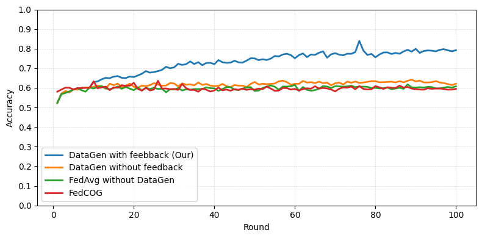
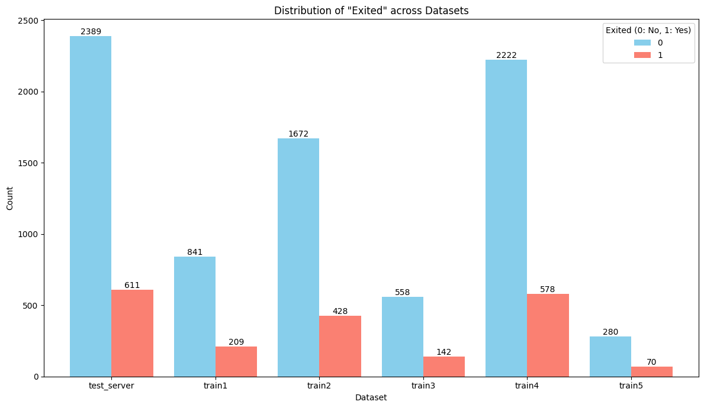

<p align="center">
  
</p>

# Domain Adaptation of Federated Learning by Data Generation and Server Feedback

[](https://doi.org/10.1007/978-981-95-4960-3_22)
[](https://doi.org/10.1007/978-981-95-4960-3_22)
[](https://caodien2003.github.io/flgenai/)
[](https://flower.ai/)

Reference implementation of **"Domain Adaptation of Federated Learning by Data Generation and Server Feedback"**, published in *MIWAI 2025* (LNAI 16354, pp. 272–283, Springer Nature Singapore).

📄 **[Paper](https://doi.org/10.1007/978-981-95-4960-3_22)** &nbsp;·&nbsp; 🌐 **[Project page](https://caodien2003.github.io/flgenai/)**

Phuong-Anh Vu¹, Kim-Tinh Phan¹, Cao-Dien Nguyen¹, Tien-Dung Cao¹ ✉, Le Trieu Phong², Ngoc-Thai Nguyen³
<sub>¹ Tan Tao University · ² NICT, Tokyo · ³ Viettel Solutions</sub>

---

## Overview

In federated learning, the server often holds a test set that represents the **target domain**, while clients train on local data drawn from somewhere else. That gap — domain shift — is what degrades the global model.

This framework closes it with a feedback loop. The current implementation uses
budget-bounded LUCB client diagnostics by default; the historical full-target
scan remains available only as an experimental baseline.

1. **The server monitors the global model separately.** Plateau and regression
   checks remain full global-model monitoring and are not charged to LUCB.
2. **LUCB diagnoses weak clients on fixed minibatches.** It ranks client error
   rates, uses Wilson confidence intervals, and stops at a confidence boundary
   or a hard model-sample budget. Evidence is reset when the client-model
   fingerprint changes.
3. **It emits only abstract feedback by default.** The server keeps selected
   client/class labels and aggregate SHAP, salient-position, or Grad-CAM patch
   metadata. It does not transmit target rows, target text, or target pixels.
4. **Clients generate from local context.** TVAE receives local feature
   statistics, text generation receives labels and position distributions, and
   image refinement uses same-label local images as canvases.

Feedback is not produced every round. It is triggered once enough rounds have passed, once client models start overfitting locally, or once the global model's accuracy on the server test set plateaus or drops.

<p align="center">
  
  <br>
  <sub><b>Text (News Category, 42 classes).</b> FedAvg, FedCOG and generation-without-feedback plateau near 0.6; feedback-guided generation keeps climbing to ≈ 0.8.</sub>
</p>

---

## LUCB feedback protocol

The dependency-free [`fl_lucb/`](fl_lucb/) package is shared by all three
tracks. It builds deterministic, non-replacement, best-effort stratified
minibatch plans; a rare text class is not duplicated merely to fill every
batch. The configuration keys are consistent across the servers:

| Key | Pilot default | Meaning |
| --- | ---: | --- |
| `selection_mode` | `lucb` | `lucb` or `legacy_full_scan` |
| `lucb_budget_fraction` | `0.25` | Fraction of the equivalent full client scan measured in model-sample evaluations |
| `lucb_batch_size` | `64` | Planned samples per client minibatch |
| `lucb_top_k` | at most `3` | Weak clients selected for feedback |
| `lucb_epsilon`, `lucb_delta` | `0.02`, `0.05` | LUCB boundary tolerance and family-wise Wilson error budget allocated across planned looks |
| `weak_class_accuracy` | `0.85` | A class is weak only when its Wilson upper accuracy bound is below this value |
| `seed` | `42` | Plan and tie-breaking seed |
| `lucb_prioritization` | `strict` | Strict evidence reset, or experimental `decay_priority` scheduling without historical evidence in a Wilson interval |

Each feedback event writes a sanitized `lucb_audit_*.json` record beneath the
configured run directory. It includes configuration, model fingerprint,
model-sample and explanation cost, confidence intervals, class coverage,
selected clients/classes, and stop reason. It deliberately excludes raw rows,
tokens, and pixels. `legacy_full_scan` is for comparison only and preserves the
previous full-evaluation flow.

---

## Branch Architecture & Research Roles

This repository is organized into distinct branches supporting rigorous empirical comparison:

| Branch | Role in Research | Key Characteristics | Status |
| :--- | :--- | :--- | :---: |
| **`main` / `tan`** | **Proposed Method** | **Budget-Bounded Minibatch LUCB Bandit** with $(\epsilon, \delta)$-PAC guarantees, Bonferroni FWER calibration, hierarchical class diagnosis via Wilson intervals, and Abstract Feedback protocol. | ✅ Primary / Production |
| **`minibatch`** | **Heuristic Baseline** | **Cumulative Minibatch Evaluation** with threshold-based early stopping ($\theta = 0.85$), global budget ceiling ($E = 0.25$), and target data leakage prevention (`--allow-target-leakage False`). | ✅ Verified Baseline |

### Comprehensive Technical Reports (`docs/`)

Detailed design documents, execution workflows, and benchmark guides are available in [`docs/`](docs/):
- 📄 **[`docs/LUONG_CHAY_CHI_TIET_CAC_BRANCH.md`](docs/LUONG_CHAY_CHI_TIET_CAC_BRANCH.md)**: End-to-end execution workflows, Mermaid sequence/flowchart diagrams, 1-to-1 mapping of LUCB outputs to paper inputs, and 5-tier server savings quantification.
- 📄 **[`docs/BAO_CAO_BRANCH_TAN_LUCB.md`](docs/BAO_CAO_BRANCH_TAN_LUCB.md)**: Technical report on Algorithm 1 (LUCB), budget bounds, Bonferroni calibration, and Section 3.5 (Hierarchical Class Diagnosis).
- 📄 **[`docs/BAO_CAO_BRANCH_MINIBATCH.md`](docs/BAO_CAO_BRANCH_MINIBATCH.md)**: Technical report on cumulative minibatch evaluation, threshold stopping, budget ceilings, and data leakage fixes.
- 📄 **[`docs/SO_SANH_VA_DANH_GIA_THUC_NGHIEM.md`](docs/SO_SANH_VA_DANH_GIA_THUC_NGHIEM.md)**: Comprehensive 3-method comparison matrix, fair benchmark execution commands, and automated benchmark aggregator guide.

### Automated Benchmark Aggregator & LaTeX Generator

Run [`tools/aggregate_benchmark.py`](tools/aggregate_benchmark.py) to automatically ingest experiment logs, profile the 5 execution stages (Eval, XAI, Restore, Synthetic Gen, Local Train), analyze weak client selection dynamics, and export Markdown / publication-grade LaTeX tables:

```bash
python tools/aggregate_benchmark.py \
    --exp-dirs logs/exp_fullscan logs/exp_minibatch logs/exp_lucb \
    --names "Baseline_FullScan" "Minibatch_Heuristic" "Proposed_LUCB" \
    --output-markdown docs/BENCHMARK_REPORT.md \
    --output-latex docs/table_benchmark.tex
```

---

## What's in this repository

| Track | Feedback signal | Generator | Model | Status |
| --- | --- | --- | --- | --- |
| [`tabular/`](tabular/) | SHAP | TVAE (SDV) | 5-layer MLP | ✅ included |
| [`text/`](text/) | Grad-CAM over tokens | Gemma-2B-it | DistilBERT | ✅ included |
| [`image/`](image/) | Grad-CAM patch coordinates | Diffusion (DDPM) | ResNet-18 | ⚠️ experimental; external assets required |

> The CIFAR-10 experiment from Section 3.2 of the paper is reported in the results below but its code is not part of this repository.

```
.
├── docs/                     # Technical reports, guides & project page
│   ├── BAO_CAO_BRANCH_TAN_LUCB.md
│   ├── BAO_CAO_BRANCH_MINIBATCH.md
│   ├── LUONG_CHAY_CHI_TIET_CAC_BRANCH.md
│   ├── SO_SANH_VA_DANH_GIA_THUC_NGHIEM.md
│   ├── index.html
│   └── assets/
├── fl_lucb/                  # dependency-free Wilson/LUCB selector and protocol validator
├── tools/                    # automated benchmark aggregator & LaTeX generator
│   └── aggregate_benchmark.py
├── tabular/                  # SHAP feedback + TVAE generation
│   ├── server_tabular.py     # FedAvg, evaluation, plateau detection, SHAP feedback
│   ├── client_tabular.py     # local training, feature restore, TVAE sampling + filtering
│   ├── dataset/7030/         # server test set + 5 non-IID client shards
│   ├── tvae_gen.pkl          # pre-trained TVAE generator
│   └── README.md             # full setup, config and troubleshooting guide
├── image/                    # experimental CIFAR-10 feedback implementation
│   ├── server.py             # LUCB or legacy selection, Grad-CAM patch metadata
│   ├── client_1.py           # canonical runtime; client_2..client_9 are wrappers
│   └── README.md             # checkpoint/data prerequisites and validation
└── text/                     # Grad-CAM feedback + Gemma generation
    ├── server_textdata.py    # FedAvg, Grad-CAM token attribution, checkpoints
    ├── client_textdata.py    # DistilBERT training + prompt-driven headline generation
    ├── data/                 # server test set + 5 non-IID client shards
    └── README.md
```

---

## Quickstart

### Tabular — Bank Customer Churn

```bash
cd tabular
conda create -n flgenai-tabular python=3.10 -y && conda activate flgenai-tabular
pip install -r requirements.txt

# terminal 1 — server (LUCB abstract feedback is the default)
python server_tabular.py --selection-mode lucb --feedback-protocol abstract \
    --log-dir runs/tabular_lucb

# terminal 2..n — one process per client shard
python client_tabular.py --client-id client1 --train-csv dataset/7030/train1.csv \
    --server-address 127.0.0.1:9000 --log-dir runs/tabular_lucb
```

Requires Python 3.8–3.11 — `torch==2.2.2` has no wheel for 3.12. Use the same `--log-dir` on server and clients so one run's artefacts land together. See [`tabular/README.md`](tabular/README.md) for every config key, the log layout, and troubleshooting (SDV pickle version, numpy BitGenerator, WSL2 OOM).

### Text — News Category

```bash
cd text
pip install -r requirements.txt

python server_textdata.py --num-rounds 30 --selection-mode lucb \
    --feedback-protocol abstract --run-dir runs/text_lucb  # terminal 1
python client_textdata.py --client-id client0 --train-csv data/client0.csv \
    --label-map runs/text_lucb/label_map.json --run-dir runs/text_lucb_clients \
    --server-address 127.0.0.1:8080                        # terminal 2..n
```

Provide a local Hugging Face token for the gated Gemma model when generation is
enabled. The supplied CSV paths are relative to `text/`; use `--help` for model
and generation options. Details are in [`text/README.md`](text/README.md).

### Image — experimental CIFAR-10

The image track needs a compatible CIFAR subset layout and
`image/cifar_diffusion.pth`; neither should be inferred from a fresh clone.

```bash
cd image
python server.py --target <target-subset> --clients 9 --selection-mode lucb \
    --feedback-protocol abstract --mode refine
python client_1.py --data <client-subset> --cid client1
```

Use `python server.py --target <target-subset> --validate-config` for startup
and protocol validation without launching Flower. See [`image/README.md`](image/README.md).

### Reproduce the historical baseline

Use a new run directory and select the explicit baseline mode:

```bash
python server_tabular.py --selection-mode legacy_full_scan --feedback-protocol legacy \
    --allow-raw-feedback --log-dir runs/tabular_legacy
```

Legacy payloads intentionally require `--allow-raw-feedback`; runtime data can
be sent only after this opt-in, while audit records remain metadata-only. Do not
write new runs into the historical `result_*` directories.

---

## Results

### Tabular — Bank Customer Churn, 30 rounds

| Method | Accuracy | Precision | Recall | F1-Score |
| --- | ---: | ---: | ---: | ---: |
| **DataGen with Feedback (ours)** | **0.9280** | **0.7770** | **0.9067** | **0.8369** |
| FedAvg without DataGen | 0.8320 | 0.6072 | 0.4959 | 0.5459 |
| DataGen without Feedback | 0.8243 | 0.5802 | 0.4975 | 0.5357 |
| Centralized Training | 0.8433 | 0.4484 | 0.6732 | 0.5383 |

Our method exceeds even centralized training. The paper attributes this to the distributional mismatch itself: the server's test set differs from the client training data, so the gain reflects adaptation to the target distribution rather than a better fit to the training pool.

### Image — CIFAR-10, 50 rounds

Ten non-IID subsets, one held out as the target set per run. Accuracy of our method — consistently above FedCOG, generation-without-feedback, and FedAvg:

| Target set 1 | Target set 5 | Target set 10 |
| ---: | ---: | ---: |
| **92.6%** | **91.1%** | **94.3%** |

### Text — News Category, 100 rounds

Baselines plateau near **0.6**; feedback-guided generation reaches ≈ **0.8** (figure above).

### Running time

| Track | Feedback cost | Generation cost | Notes |
| --- | --- | --- | --- |
| Tabular | ≈ 50 s | — | ≈ 150 s per client per round; < 50 min for 30 rounds |
| CIFAR-10 | ≈ 80 s / client | up to 900 s | 200 images per class; generation fires in ~16–18 of 50 rounds |
| Text | ≈ 2 h (Grad-CAM) | ≈ 5 h / 2,500 samples | vs. 1.5 h without feedback; FedAvg round ≈ 743 s, FedCOG ≈ 1,260 s |

---

## Data

Both tracks ship pre-split non-IID shards — one server test set (the target domain) and five client shards.

| Shard | Tabular (rows) | Text (rows) |
| --- | ---: | ---: |
| Server test set | 3,000 | 10,979 |
| Client 1 | 1,050 | 48,740 |
| Client 2 | 2,100 | 69,641 |
| Client 3 | 700 | 31,426 |
| Client 4 | 2,800 | 28,196 |
| Client 5 | 350 | 20,517 |

Tabular shards come from a 70/30 split of the [Bank Customer Churn](https://www.kaggle.com/datasets/radheshyamkollipara/bank-customer-churn/) dataset (19 features + the `Exited` label). Text shards come from the [News Category](https://www.kaggle.com/datasets/rmisra/news-category-dataset) dataset, Dirichlet-partitioned with β = 0.05 so each shard has a different set of dominant categories across the 42 classes.

<p align="center">
  
  <br>
  <sub>Label distribution across the tabular shards — uneven in both size and class balance.</sub>
</p>

---

## Privacy

- **Abstract is the default protocol.** Tabular feedback contains weak labels
  and aggregate feature rankings; text feedback contains labels and coarse
  salient-position distributions; image feedback contains labels and Grad-CAM
  patch coordinates. No server target row, target text, or target pixel is
  included.
- **Legacy is an explicit compatibility mode.** It requires both
  `--feedback-protocol legacy` and `--allow-raw-feedback`, emits a warning, and
  never writes raw material to an audit record.
- **Audit logs are intentionally metadata-only.** They can be shared for
  experimental comparison without disclosing the runtime raw legacy payload.

The protocol is an engineering privacy boundary, not a formal differential
privacy guarantee. Differential privacy remains future work.

For a Vietnamese code-to-baseline mapping, configuration reference, privacy
protocol summary, and verified test record, see
[`docs/Bao_cao_thay_doi_ky_thuat_LUCB.docx`](docs/Bao_cao_thay_doi_ky_thuat_LUCB.docx).

---

## Citation

```bibtex
@inproceedings{vu2026domain,
  author    = {Vu, Phuong-Anh and Phan, Kim-Tinh and Nguyen, Cao-Dien and
               Cao, Tien-Dung and Phong, Le Trieu and Nguyen, Ngoc-Thai},
  title     = {Domain Adaptation of Federated Learning by Data Generation
               and Server Feedback},
  booktitle = {Multi-disciplinary International Conference on Artificial
               Intelligence (MIWAI 2025)},
  series    = {Lecture Notes in Artificial Intelligence},
  volume    = {16354},
  pages     = {272--283},
  publisher = {Springer Nature Singapore},
  year      = {2026},
  doi       = {10.1007/978-981-95-4960-3_22}
}
```

---

## Acknowledgements

This research is supported by the Tan Tao University (TTU) Foundation for Science and Technology Development under Grant No. TTU.RS.25.102.003. The work of L. T. Phong is supported in part by the JST CREST Grant JPMJCR21M1, Japan.

Built with [Flower](https://flower.ai/), [SHAP](https://github.com/shap/shap), [SDV](https://docs.sdv.dev/sdv), [DistilBERT](https://huggingface.co/docs/transformers/en/model_doc/distilbert) and [Gemma](https://huggingface.co/docs/transformers/en/model_doc/gemma).

## Contact

- Tien-Dung Cao (corresponding author) — dung.cao@ttu.edu.vn
