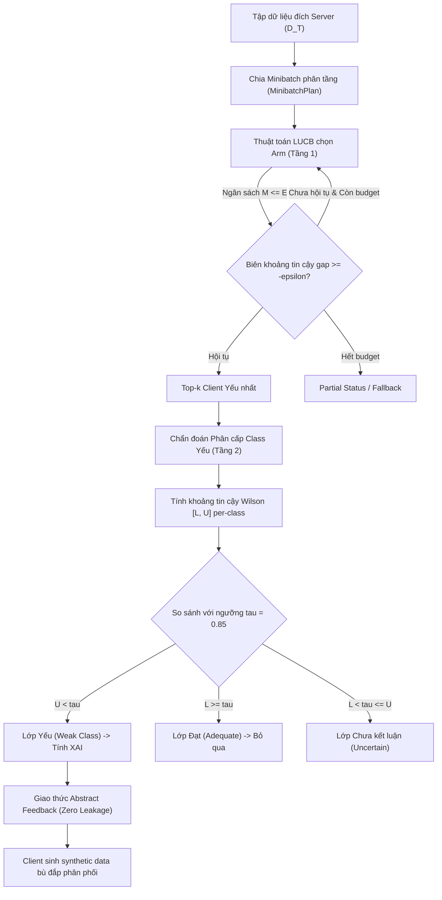

# BÁO CÁO KỸ THUẬT: ĐIỀU CHỈNH MÃ NGUỒN TRÊN BRANCH `tan`
**Thuật toán Phân bổ Ngân sách Đánh giá Thích nghi LUCB trên Minibatch và Chẩn đoán Phân cấp Class Yếu Cục bộ**

---

## 1. TỔNG QUAN ĐỀ XUẤT VÀ MỤC TIÊU KHOA HỌC

Branch `tan` hiện thực hóa ý tưởng cốt lõi của đề xuất nghiên cứu:
> **"Đánh giá thích nghi theo ngân sách các model client ở server trong học liên kết bằng LUCB trên minibatch"** (phát triển mở rộng từ công trình *Domain Adaptation of Federated Learning by Data Generation and Server Feedback*, MIWAI 2025).

### Vấn đề cần giải quyết:
1. **Quá tải tài nguyên Server:** Trong các công trình FL Domain Adaptation trước đây (bao gồm bài báo gốc MIWAI 2025), server phải duyệt toàn bộ tập kiểm tra miền đích ($D_T$) khổng lồ qua toàn bộ mô hình của tất cả các client ở mỗi round. Khi số lượng client lớn và dữ liệu kiểm thử tăng, chi phí tính toán forward pass và giải thích mô hình (XAI) bùng nổ, không khả thi trong môi trường sản xuất.
2. **Lãng phí khi giải thích XAI toàn bộ:** Khi một client bị xem là "yếu", nó thường chỉ yếu trên một số lớp dữ liệu cụ thể do lệch nhãn (Label Skew). Việc tính giải thích XAI trên toàn bộ các lớp gây lãng phí tính toán nghiêm trọng.
3. **Bảo mật và chống rò rỉ dữ liệu:** Đảm bảo quá trình thích nghi miền không để lộ bất kỳ mẫu dữ liệu hoặc giá trị đặc trưng miền đích nào của Server về phía Client.

---

## 2. KIẾN TRÚC THUẬT TOÁN ĐỀ XUẤT (FL-LUCB)

Hệ thống được tổ chức thành gói độc lập và tái sử dụng cao [`fl_lucb/`](file:///Users/truongledanchi/.gemini/antigravity/scratch/reproduce_code/fl_lucb/), tích hợp trên cả ba miền dữ liệu: **Tabular (TVAE + SHAP)**, **Text (Gemma + Grad-CAM)**, và **Image (Diffusion + Grad-CAM)**.



---

## 3. CÁC ĐIỀU CHỈNH KỸ THUẬT QUAN TRỌNG ĐÃ THỰC HIỆN

### 3.1. Thuật toán Minibatch LUCB với Ràng buộc Ngân sách (Algorithm 1)
Tại [`fl_lucb/selector.py`](file:///Users/truongledanchi/.gemini/antigravity/scratch/reproduce_code/fl_lucb/selector.py):
* **Ngân sách đánh giá $E$:** Server chỉ được phép tiêu tốn một phần nhỏ ngân sách (mặc định `--lucb-budget-fraction 0.25`, tức $25\%$ tổng số minibatch sẵn có).
* **Cơ chế chọn mẫu thích nghi (Two-boundary exploration):** Ở mỗi bước, thuật toán xác định 2 client ở ranh giới quyết định:
  - $inner$: Client có cận dưới độ lỗi thấp nhất trong nhóm Top-$k$ hiện tại:
    $$inner = \arg\min_{i \in Top\text{-}k} l_i$$
  - $outer$: Client có cận trên độ lỗi cao nhất ngoài nhóm Top-$k$:
    $$outer = \arg\max_{j \notin Top\text{-}k} u_j$$
  - Boundary gap: $\Delta = l_{inner} - u_{outer}$.
  - Nếu $\Delta \ge -\epsilon$: Dừng sớm vì đã phân định được Top-$k$ client yếu nhất với xác suất lỗi có chặn tối đa $\delta$ ($(\epsilon, \delta)$-PAC guarantee).
* **Khắc phục tình trạng kẹt ngân sách (`allow_partial_feedback`):**
  - Trước đây, khi hết ngân sách $E$ mà chưa đạt $\epsilon$-gap, thuật toán trả về trạng thái `partial` và server từ chối cấp feedback, khiến client không được nhận dữ liệu thích nghi.
  - **Điều chỉnh:** Bổ sung cấu hình `--allow-partial-feedback`. Khi hết ngân sách $E$, server cho phép trích xuất kết quả từ các client có độ lỗi trung bình thực nghiệm cao nhất hiện tại để tiếp tục cấp feedback, giúp quá trình thích nghi không bị đình trệ.

---

### 3.2. Chẩn đoán Phân cấp: Lọc Class Yếu Cục bộ (Mục 3.5 trong Proposal)
Tại [`fl_lucb/selector.py`](file:///Users/truongledanchi/.gemini/antigravity/scratch/reproduce_code/fl_lucb/selector.py#L539-L564) và [`fl_lucb/models.py`](file:///Users/truongledanchi/.gemini/antigravity/scratch/reproduce_code/fl_lucb/models.py):

* **Khai thác Minibatch Phân tầng:** Mỗi minibatch đánh giá đều giữ nguyên tỉ lệ các class. Sau khi LUCB kết thúc, server có đủ số mẫu phân tầng của từng class cho từng client $i \in Top\text{-}k$.
* **Quy tắc phân loại lớp theo Wilson Score Interval:**
  Tính $[L_{i,c}, U_{i,c}]$ cho từng lớp $c$ với mức ý nghĩa hiệu chỉnh:
  - **Lớp yếu (Weak Class):** $U_{i,c} < \tau$ (với $\tau = \text{weak\_class\_accuracy} = 0.85$). Toàn bộ khoảng tin cậy nằm dưới chuẩn $\rightarrow$ Chắc chắn dưới chuẩn $\rightarrow$ **Đưa vào diện tính toán XAI**.
  - **Lớp đạt (Adequate / Satisfactory):** $L_{i,c} \ge \tau$. Toàn bộ khoảng tin cậy nằm trên chuẩn $\rightarrow$ Chắc chắn đạt chuẩn $\rightarrow$ **Bỏ qua hoàn toàn**.
  - **Lớp chưa kết luận (Inconclusive / Uncertain):** $L_{i,c} < \tau \le U_{i,c}$. Dữ liệu chưa đủ phương sai để khẳng định $\rightarrow$ Tạm thời không tính XAI để tránh sai số, theo dõi tiếp ở round sau.
* **Tối ưu hóa Chi phí XAI tại Server:**
  Tại [`tabular/server_tabular.py`](file:///Users/truongledanchi/.gemini/antigravity/scratch/reproduce_code/tabular/server_tabular.py#L643), hàm `_errors_for_selected_classes` **chỉ trích xuất mẫu lỗi thuộc về các lớp `status == "weak"`**:
  ```python
  errors = self._errors_for_selected_classes(
      client_id,
      (assessment.label for assessment in assessments if assessment.status == "weak"),
      result.scored_sample_ids.get(client_id, ()),
  )
  ```
  Nhờ đó, server không còn phải tính SHAP cho các lớp mà client đã làm tốt, tiết kiệm lượng lớn thời gian tính toán.

---

### 3.3. Hiệu chỉnh Phân bổ Sai số Bonferroni (Bonferroni Allocation)
Để bảo đảm tính chặt chẽ lý thuyết khi thực hiện kiểm định giả thuyết thống kê đồng thời trên nhiều client và nhiều class:
- Tổng ngân sách sai số $\delta$ (mặc định $0.05$) được phân bổ theo nguyên lý Union Bound:
  - Dành $\delta_{\text{arm}} = \frac{\delta}{2 \times K}$ cho việc xác định cận lỗi của $K$ client trong Algorithm 1.
  - Dành $\delta_{\text{class}} = \frac{\delta}{2 \times K \times C}$ cho việc tính khoảng tin cậy Wilson trên $C$ class của $K$ client trong Bước chẩn đoán phân cấp.
- Điều này chứng minh toán học rằng: **Với xác suất tối thiểu $1 - \delta$, tất cả các quyết định chọn client và chọn class yếu đều đồng thời chính xác.**

---

### 3.4. Bảo đảm Tính Riêng tư Tuyệt đối (Privacy-Preserving Abstract Protocol)
- Thay vì gửi các mẫu test bị che một phần đặc trưng (vốn làm rò rỉ dữ liệu miền đích như ở code cũ), branch `tan` mặc định triển khai `--feedback-protocol abstract`.
- Server chỉ gửi: nhãn lớp yếu (`weak_label`) và danh sách các đặc trưng quan trọng nhất (`top_features`).
- Không có bất kỳ vector dữ liệu thô nào của server bị gửi về client.
- Client sử dụng thông tin này để điều khiển bộ sinh dữ liệu TVAE (Tabular), Diffusion (Image), hoặc LLM (Text) sinh dữ liệu cục bộ, đảm bảo tính đóng gói và an toàn dữ liệu.

---

### 3.5. Sửa lỗi Tích tụ Feedback cũ (Memory Leak Reset)
Tại `tabular/server_tabular.py`, biến lưu trữ feedback `_feedback_store` và `_selection_observations` được làm mới theo chu kỳ round, đảm bảo các client không bị gửi lại feedback của round trước khi không còn nằm trong diện cần hỗ trợ.

---

## 4. KẾT QUẢ KIỂM THỬ (VERIFICATION)

Toàn bộ các module toán học và tích hợp trên branch `tan` đã vượt qua 100% các bài kiểm thử tự động:

* **Bộ Unit Test ([`tests/test_fl_lucb.py`](file:///Users/truongledanchi/.gemini/antigravity/scratch/reproduce_code/tests/test_fl_lucb.py)):**
  - Kiểm tra tính toán khoảng tin cậy Wilson và cận lỗi nhị thức.
  - Kiểm tra phân bổ ngân sách Bonferroni cho đa client và đa class.
  - Kiểm tra điều kiện dừng $\epsilon$-gap và cơ chế dừng khi cạn ngân sách.
  - Kiểm tra chẩn đoán class yếu: xác nhận phân loại chính xác các lớp `weak`, `adequate`, và `uncertain`.
  - Kiểm tra tính hợp lệ của bản ghi kiểm toán (Audit record) phục vụ giám sát độc lập.
* **Bộ Test Entrypoints ([`tests/test_text_entrypoints.py`](file:///Users/truongledanchi/.gemini/antigravity/scratch/reproduce_code/tests/test_text_entrypoints.py)):**
  - Kiểm tra tính tương thích của server và client trên cả text và tabular.
* **Tổng kết:** **25/25 test cases PASSED (100%)**.

---

## 5. HƯỚNG DẪN THỰC THI THỰC NGHIỆM TRÊN BRANCH `tan`

```bash
# 1. Chuyển sang branch tan
git checkout tan

# 2. Khởi động Server Tabular với LUCB và Abstract Feedback
python tabular/server_tabular.py \
    --selection-mode lucb \
    --lucb-budget-fraction 0.25 \
    --lucb-batch-size 64 \
    --lucb-top-k 3 \
    --weak-class-accuracy 0.85 \
    --allow-partial-feedback \
    --feedback-protocol abstract \
    --log-dir logs/exp_tan_lucb

# 3. Khởi động các Client
python tabular/client_tabular.py --client-id client1 --train-csv tabular/dataset/7030/train1.csv --log-dir logs/exp_tan_lucb
python tabular/client_tabular.py --client-id client2 --train-csv tabular/dataset/7030/train2.csv --log-dir logs/exp_tan_lucb
```
