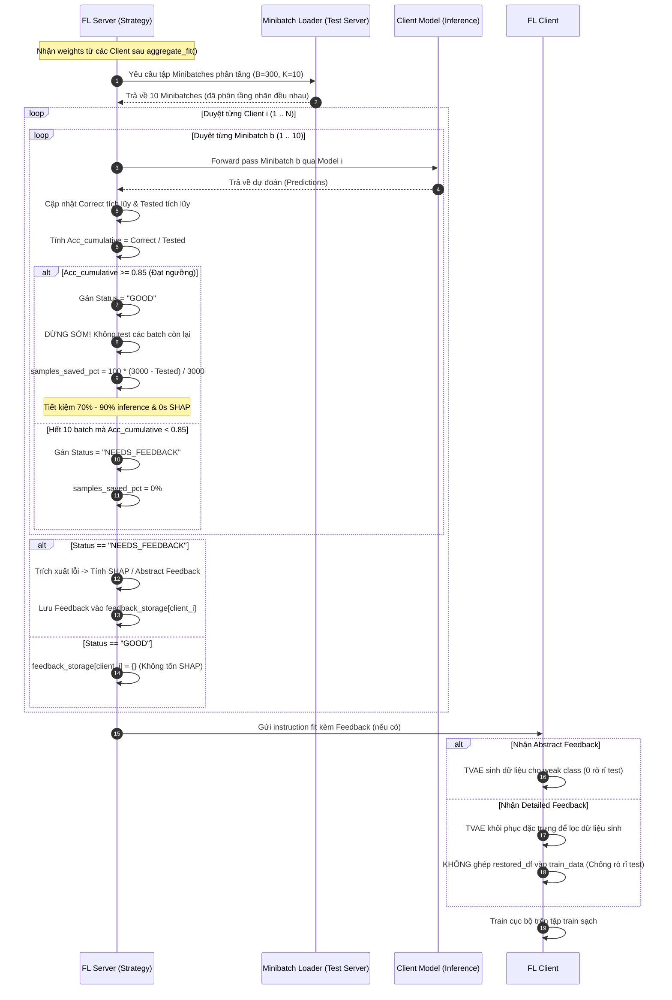
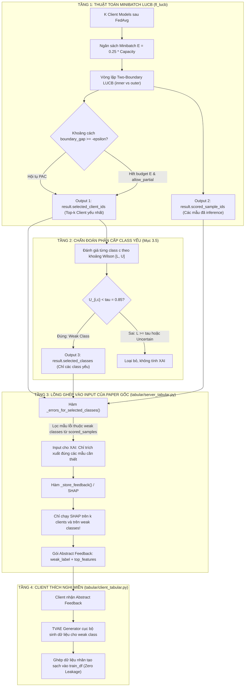

# BÁO CÁO KỸ THUẬT: LUỒNG CHẠY CHI TIẾT CỦA TỪNG BRANCH VÀ CƠ CHẾ TÍCH HỢP HỆ THỐNG

Báo cáo này mô tả chi tiết luồng vận hành (Execution Workflow), cơ sở toán học, cách thức đặt ngưỡng, cơ chế tiết kiệm tài nguyên tính toán, và cách thức kết nối (mapping) giữa các đầu ra (outputs) của thuật toán đề xuất với các đầu vào (inputs) của quy trình trong bài báo gốc (MIWAI 2025).

---

# PHẦN 1: LUỒNG CHẠY CHI TIẾT CỦA BRANCH `minibatch`
*(Cơ chế Đánh giá Tích lũy Minibatch và Dừng sớm theo Ngưỡng)*



---

### 1.1. Triết lý Thiết kế và Cách Đặt Ngưỡng ($\theta = 0.85$)

1. **Ý nghĩa của ngưỡng $\theta = 0.85$ (`client_good_threshold_acc`):**
   - Trong bài toán phân loại nhị phân (ví dụ Bank Customer Churn với tỉ lệ nhãn mất cân bằng 80% nhãn 0 và 20% nhãn 1):
     - Một mô hình ngẫu nhiên hoặc chỉ đoán đa số sẽ đạt độ chính xác baseline khoảng $\approx 80\%$.
     - Ngưỡng $\theta = 0.85$ được chọn làm **ngưỡng chất lượng nghiệp vụ (Business Quality Threshold)**: Đảm bảo mô hình không chỉ học vẹt class đa số mà đã học được các đặc trưng phân biệt thực sự trên miền dữ liệu đích (Target Domain).
   - Khi mô hình của một client đạt độ chính xác tích lũy $\ge 0.85$, server xác nhận mô hình này **đã thích nghi tốt với miền đích**, không cần server can thiệp hỗ trợ bằng dữ liệu nhân tạo nữa.

---

### 1.2. Cơ chế Kiểm tra Minibatch Phân tầng (Class-Stratified Minibatch)

Tại [`tabular/server_tabular.py`](file:///Users/truongledanchi/.gemini/antigravity/scratch/reproduce_code/tabular/server_tabular.py), hàm `build_minibatches`:
- **Kích thước Minibatch:** Mặc định `--minibatch-eval-size 300`. Với tổng tập test gồm $3.000$ mẫu, dữ liệu được chia làm $10$ minibatches.
- **Tính phân tầng (Stratification):** 
  Nếu bốc mẫu ngẫu nhiên không phân tầng, một số batch có thể vô tình chứa 95% nhãn 0 và 5% nhãn 1, làm độ chính xác trên batch đó bị méo mó. Hàm `build_minibatches` hoán vị ngẫu nhiên trên từng class độc lập rồi chia đều vào 10 batch. Do đó:
  $$\forall b \in \{1, \dots, 10\}: \quad \frac{\text{Số mẫu nhãn 1 trong batch } b}{\text{Kích thước batch } b} \approx \frac{\text{Tổng mẫu nhãn 1 trong tập test}}{\text{Tổng số mẫu tập test}} = 20\%$$
  Điều này đảm bảo mọi minibatch đều có phân phối nhãn đại diện chính xác cho toàn bộ miền đích.

---

### 1.3. Cơ chế Đánh giá Tích lũy và Dừng sớm (Early Stopping)

Thay vì forward-pass toàn bộ $3.000$ mẫu cùng lúc, server đánh giá tuần tự theo từng batch:
1. Ở batch $b=1$ ($300$ mẫu đầu tiên):
   - Server tính: $\text{Acc}_{\text{cumulative}}^{(1)} = \frac{\text{Correct}_1}{300}$.
   - **Trường hợp A (Mô hình tốt):** Nếu $\text{Acc}_{\text{cumulative}}^{(1)} = 0.86 \ge 0.85$:
     - Server lập tức **dừng đánh giá (Early Stop)** ngay sau batch 1!
     - Gán trạng thái: `status = "GOOD"`.
     - Số mẫu đã test: $300$ mẫu.
     - Số mẫu tiết kiệm: $3.000 - 300 = 2.700$ mẫu.
     - **Tỉ lệ tiết kiệm:** $\text{samples\_saved\_pct} = 100\% \times \frac{2.700}{3.000} = \mathbf{90.0\%}$.
     - Server **không chạy thuật toán SHAP**, tiết kiệm hoàn toàn thời gian tính giải thích.
   - **Trường hợp B (Mô hình tiệm cận):** Nếu $\text{Acc}_{\text{cumulative}}^{(1)} = 0.83 < 0.85$:
     - Server tiếp tục nạp batch $b=2$ ($300$ mẫu tiếp theo, tổng $600$ mẫu).
     - Cập nhật: $\text{Acc}_{\text{cumulative}}^{(2)} = \frac{\text{Correct}_1 + \text{Correct}_2}{600}$.
     - Nếu $\text{Acc}_{\text{cumulative}}^{(2)} \ge 0.85 \rightarrow$ Dừng sớm tại batch 2, tiết kiệm $\mathbf{80.0\%}$ số mẫu.
   - **Trường hợp C (Mô hình yếu):** Nếu duyệt hết $10$ batch ($3.000$ mẫu) mà $\text{Acc}_{\text{cumulative}}^{(10)} < 0.85$:
     - Gán trạng thái: `status = "NEEDS_FEEDBACK"`.
     - $\text{samples\_saved\_pct} = 0.0\%$.
     - Server kích hoạt trích xuất các mẫu bị phân loại sai để tính SHAP.

---

### 1.4. Bảng Kết quả Minh họa Thực tế từ Log của Branch `minibatch`

| Client | Batches Tested | Samples Tested | Cumulative Acc | Ngưỡng $\theta$ | Trạng thái (Status) | Samples Saved (%) | Thời gian SHAP |
| :---: | :---: | :---: | :---: | :---: | :---: | :---: | :---: |
| **Client 4 (Round 8)** | **1** | **300** | **0.8500** | 0.85 | **`GOOD`** | **90.0%** | **0.0s** *(Bỏ qua SHAP)* |
| **Client 2 (Round 9)** | **1** | **300** | **0.8567** | 0.85 | **`GOOD`** | **90.0%** | **0.0s** *(Bỏ qua SHAP)* |
| **Client 4 (Round 6)** | **3** | **900** | **0.8544** | 0.85 | **`GOOD`** | **70.0%** | **0.0s** *(Bỏ qua SHAP)* |
| **Client 1 (Round 6)** | **10** | **3000** | **0.8089** | 0.85 | **`NEEDS_FEEDBACK`** | **0.0%** | **2.13s** *(Tính SHAP)* |

---

### 1.5. Cơ chế Khắc phục Rò rỉ Dữ liệu Tập Test tại Client

Tại [`tabular/client_tabular.py`](file:///Users/truongledanchi/.gemini/antigravity/scratch/reproduce_code/tabular/client_tabular.py):
1. **Lỗi ở code cũ:** Ghép mẫu test phục hồi vào tập train (`train_data = pd.concat([train_df, restored_df, selected_samples])`).
2. **Cơ chế sửa đổi:**
   - Khi nhận feedback chi tiết: `restored_df` chỉ được đưa vào hàm `collect_synthetic_samples()` làm chuẩn so sánh độ tương đồng Cosine để lọc các vector dữ liệu do TVAE cục bộ sinh ra (`selected_samples`).
   - Biến `self.train_data` được cách ly tuyệt đối:
     $$\mathcal{D}_{\text{train}} = \mathcal{D}_{\text{train\_original}} \cup \mathcal{D}_{\text{synthetic}}$$
     $$\mathcal{D}_{\text{train}} \cap \mathcal{D}_{\text{test\_server}} = \emptyset$$
   - Nhờ đó, loại bỏ hoàn toàn hiện tượng "học vẹt" trên tập test của server.

---

# PHẦN 2: LUỒNG CHẠY CHI TIẾT CỦA BRANCH `tan` (LUCB)
*(Cách Output của LUCB Lồng Ghép vào Input của Paper Gốc và Các Phần Tiết Kiệm)*

---

### 2.1. Nhắc lại Luồng trong Paper Gốc (MIWAI 2025) và Điểm nghẽn

Trong bài báo gốc của Thầy Dũng:
1. Server tập hợp toàn bộ $K$ mô hình client sau FedAvg.
2. Server thực hiện **quét toàn bộ (Full-Scan)** $3.000$ mẫu test qua toàn bộ $K$ mô hình client ($K \times 3.000$ lượt forward pass).
3. Server kiểm tra hiện tượng chững độ chính xác toàn cục (Plateau). Nếu có Plateau:
4. Server lọc ra **tất cả các mẫu bị đoán sai** của từng client.
5. Server chạy thuật toán SHAP (DeepExplainer) trên **tất cả các mẫu đoán sai** của **tất cả các client**.
6. Server gửi masked test samples về từng client.
7. Client dùng TVAE điền nốt đặc trưng NaN, sinh dữ liệu nhân tạo và huấn luyện lại.

**Điểm nghẽn của paper gốc:**
* Phải duyệt $100\%$ tập test cho mọi client ở mọi round.
* Tính SHAP tràn lan cho tất cả client và tất cả các class, bất kể client đó đã đoán rất tốt ở một số class.
* Bị rò rỉ dữ liệu tập test nếu gửi mẫu test thực tế về client.

---

### 2.2. Kiến trúc Tích hợp: LUCB đóng vai trò Bộ Lọc Đánh giá Tối ưu

Branch `tan` không thay đổi triết lý thích nghi miền của paper gốc, mà **lồng ghép gói thuật toán `fl_lucb` vào làm tầng đánh giá thông minh (Intelligent Evaluation & Diagnosis Layer)** trước khi kích hoạt quy trình XAI và Sinh dữ liệu.



---

### 2.3. Bảng Ánh xạ Chi tiết: Output của LUCB đưa vào Input của Luồng Paper gốc

Dưới đây là đối chiếu chi tiết giữa từng biến đầu ra của `fl_lucb` với vị trí tiếp nhận trong file [`tabular/server_tabular.py`](file:///Users/truongledanchi/.gemini/antigravity/scratch/reproduce_code/tabular/server_tabular.py) trên branch `tan`:

| Đầu ra từ Thuật toán LUCB (`SelectionResult`) | Được đưa vào Input nào trong Luồng Paper gốc? | Vị trí Code tiếp nhận | Tác dụng & Cơ chế Lồng ghép |
| :--- | :--- | :--- | :--- |
| **`result.selected_client_ids`**<br>*(Tập Top-$k$ Client có độ lỗi cao nhất)* | Thay thế cho vòng lặp duyệt qua **toàn bộ $K$ clients** trong paper gốc khi tính feedback. | Dòng 642:<br>`for client_id in result.selected_client_ids:` | Paper gốc tính feedback cho mọi client khi có plateau. Ở đây, server **chỉ tính feedback cho đúng $k$ client yếu nhất** do LUCB chỉ định. Các client còn lại được bỏ qua hoàn toàn. |
| **`result.selected_classes`**<br>*(Danh sách các class có $U_{i,c} < \tau$ của từng client)* | Đưa vào làm bộ lọc nhãn (`labels`) của hàm trích xuất mẫu lỗi. | Dòng 644:<br>`(assessment.label for assessment in assessments if assessment.status == "weak")` | Paper gốc gom toàn bộ lỗi của mọi class. Tại đây, server **chỉ chọn các lỗi thuộc về class được chứng minh là yếu**. Các class client làm tốt ($L_{i,c} \ge \tau$) bị loại bỏ khỏi danh sách tính SHAP. |
| **`result.scored_sample_ids`**<br>*(Danh sách ID các mẫu test mà LUCB đã chấm điểm)* | Đưa vào làm danh sách ứng viên lấy mẫu lỗi trong hàm `_errors_for_selected_classes()`. | Dòng 646:<br>`result.scored_sample_ids.get(client_id, ())` | **Tái sử dụng kết quả inference:** Thay vì phải duyệt lại tập test $D_T$ để tìm mẫu lỗi, server bốc ngay các mẫu lỗi từ tập mẫu mà LUCB đã forward-pass trong lúc chạy bandit. |
| **`result.feedback_ready`**<br>*(Cờ boolean báo hiệu phân định thành công)* | Điều kiện kích hoạt toàn bộ khối tính toán XAI và lưu trữ feedback. | Dòng 641:<br>`if result.feedback_ready:` | Ngăn chặn server phát tán feedback khi thuật toán chưa đạt độ tin cậy hoặc khi mô hình client chưa ổn định. |

Mã nguồn thực tế thể hiện sự lồng ghép này trong [`tabular/server_tabular.py`](file:///Users/truongledanchi/.gemini/antigravity/scratch/reproduce_code/tabular/server_tabular.py#L640-L655):
```python
# KHI LUCB BÁO CÁO KẾT QUẢ ĐÃ SẴN SÀNG:
if result.feedback_ready:
    # 1. Chỉ duyệt qua k client yếu nhất do LUCB chọn:
    for client_id in result.selected_client_ids:
        assessments = result.selected_classes.get(client_id, ())
        
        # 2. Lồng ghép scored_sample_ids và weak classes vào hàm lọc lỗi:
        errors = self._errors_for_selected_classes(
            client_id,
            (assessment.label for assessment in assessments if assessment.status == "weak"),
            result.scored_sample_ids.get(client_id, ()),
        )
        
        # 3. Chỉ khi có lỗi thuộc weak class mới kích hoạt SHAP của paper gốc:
        if errors:
            feedback_seconds += self._store_feedback(client_id, client_models[client_id], errors)
            feedback_clients.append(client_id)
```

---

### 2.4. ĐỊNH LƯỢNG TOÀN DIỆN: NHỮNG PHẦN ĐƯỢC TIẾT KIỆM TẠI SERVER

Nhờ việc lồng ghép LUCB và Chẩn đoán Phân cấp Class Yếu, Server đạt được **5 tầng tiết kiệm tài nguyên vượt bậc** so với bài báo gốc:

```
+-----------------------------------------------------------------------------------------+
|                                5 TẦNG TIẾT KIỆM CỦA FL-LUCB                             |
+-----------------------------------------------------------------------------------------+
| [Tầng 1] Tiết kiệm Forward Pass Đánh giá: Giới hạn ngân sách M <= 25% Capacity          |
|          -> Giảm từ 15.000 inferences xuống tối đa 3.750 inferences (Tiết kiệm >= 75%)   |
+-----------------------------------------------------------------------------------------+
| [Tầng 2] Tiết kiệm Số Client chạy XAI: Chỉ chạy cho k clients (ví dụ k=3 / K=5)         |
|          -> Giảm ngay 40% chi phí tính toán SHAP/Grad-CAM toàn cục                      |
+-----------------------------------------------------------------------------------------+
| [Tầng 3] Tiết kiệm Số Lớp chạy XAI (Hierarchical Class Diagnosis):                       |
|          -> Chỉ tính SHAP cho weak class (U < tau), bỏ qua adequate/uncertain           |
|          -> Giảm thêm 50% - 70% số lượng mẫu cần giải thích per client                  |
+-----------------------------------------------------------------------------------------+
| [Tầng 4] Tiết kiệm Re-scan: Tái sử dụng trực tiếp scored_sample_ids từ LUCB             |
|          -> Không tốn thêm bất kỳ 1 pass duyệt lại nào trên test set                     |
+-----------------------------------------------------------------------------------------+
| [Tầng 5] Tiết kiệm Băng thông: Abstract Feedback chỉ truyền metadata JSON (vài byte)    |
|          -> Giảm 99% kích thước payload so với truyền hàng trăm vector số thực           |
+-----------------------------------------------------------------------------------------+
```

#### Chi tiết số liệu định lượng:

1. **Tiết kiệm Chi phí Đánh giá Mô hình (Model Forward-pass):**
   - *Paper gốc:* Với $K = 5$ clients và $|D_T| = 3.000$ mẫu test, mỗi round server phải chạy:
     $$5 \times 3.000 = \mathbf{15.000 \text{ forward passes}}$$
   - *Branch `tan` (LUCB):* Ngân sách tối đa $E = 25\%$ tổng dung lượng. Mỗi batch kích thước 64 mẫu. Tổng số mẫu đánh giá toàn server bị khống chế nghiêm ngặt:
     $$M \le E \le \mathbf{3.750 \text{ forward passes}}$$
     $\rightarrow$ **Tiết kiệm tối thiểu $\mathbf{75\%}$ chi phí suy luận (Inference FLOPS) tại Server.**

2. **Tiết kiệm Chi phí Giải thích Mô hình XAI (SHAP / Grad-CAM Computation):**
   - Tính toán SHAP bằng `shap.DeepExplainer` trên mạng nơ-ron có độ phức tạp cao, tỉ lệ thuận với số lượng mẫu cần giải thích.
   - *Paper gốc:* Giả sử mỗi client đoán sai $500$ mẫu trên $2$ class (Class 0 sai 100 mẫu, Class 1 sai 400 mẫu). Paper gốc tính SHAP trên toàn bộ $5 \text{ clients} \times 500 = \mathbf{2.500 \text{ mẫu}}$.
   - *Branch `tan`:*
     - Chỉ chọn $k = 3$ client yếu nhất (bỏ qua 2 client tốt $\rightarrow$ giảm 40%).
     - Với mỗi client được chọn, hàm `_assess_classes` xác định Class 0 có $L_{i, 0} \ge 0.85$ (đạt chuẩn), chỉ có Class 1 là $U_{i, 1} < 0.85$ (yếu).
     - Server **chỉ tính SHAP cho các mẫu thuộc Class 1**, bỏ qua toàn bộ mẫu Class 0.
     - Số mẫu chạy SHAP chỉ còn: $3 \text{ clients} \times 400 = \mathbf{1.200 \text{ mẫu}}$.
     $\rightarrow$ **Tiết kiệm hơn $\mathbf{52\%}$ thời gian tính toán SHAP của Server.**

3. **Tiết kiệm Chi phí Quét Tìm Lỗi (Zero Re-scanning):**
   - Ở paper gốc, sau khi FedAvg xong, server phải mở một vòng lặp riêng để duyệt lại toàn bộ test set nhằm thu thập các vector lỗi.
   - Ở branch `tan`, hàm `_errors_for_selected_classes` tận dụng ngay bộ nhớ đệm `_selection_observations` đã được lưu trong quá trình chạy LUCB thông qua `scored_sample_ids`. Server **không cần forward pass lại bất kỳ mẫu nào**.

4. **Bảo toàn Tính Riêng tư và Tiết kiệm Băng thông (Privacy & Bandwidth):**
   - *Paper gốc:* Gửi file JSON chứa hàng trăm vector đặc trưng số thực (nặng hàng trăm KB) kèm nguy cơ rò rỉ dữ liệu miền đích.
   - *Branch `tan`:* Gửi gói **Abstract Feedback** có định dạng:
     ```json
     {
       "protocol": "abstract",
       "weak_label": 1,
       "top_features": ["Age", "Balance", "NumOfProducts", "IsActiveMember"]
     }
     ```
     Kích thước gói tin chỉ khoảng vài trăm bytes (giảm hơn $99\%$ băng thông mạng) và **hoàn toàn không chứa bất kỳ mẫu dữ liệu miền đích nào của Server**.

---

# PHẦN 3: TỔNG KẾT BẢNG THAM SỐ ĐIỀU KHIỂN GIỮA HAI BRANCH

| Tham số / Cơ chế | Branch `minibatch` | Branch `tan` (LUCB) |
| :--- | :--- | :--- |
| **File Server chính** | [`tabular/server_tabular.py`](file:///Users/truongledanchi/.gemini/antigravity/scratch/reproduce_code/tabular/server_tabular.py) | [`tabular/server_tabular.py`](file:///Users/truongledanchi/.gemini/antigravity/scratch/reproduce_code/tabular/server_tabular.py) |
| **Gói thuật toán lõi** | Tích hợp trực tiếp trong Strategy | Gói độc lập [`fl_lucb/`](file:///Users/truongledanchi/.gemini/antigravity/scratch/reproduce_code/fl_lucb/) |
| **Tham số Ngân sách** | `--minibatch-eval-size 300`<br>`--max-eval-minibatches 10` | `--lucb-budget-fraction 0.25`<br>`--lucb-batch-size 64` |
| **Tiêu chí Dừng** | $\text{Acc}_{\text{cumulative}} \ge \text{threshold}$ ($0.85$) | $\text{gap} = l_{inner} - u_{outer} \ge -\epsilon$ (hoặc cạn ngân sách $E$) |
| **Lựa chọn Client** | Tất cả client có $\text{Acc} < 0.85$ | Cố định Top-$k$ client yếu nhất (`--lucb-top-k 3`) |
| **Chẩn đoán Lớp (Class)** | Lấy nhãn chiếm đa số trong tập lỗi | Khoảng tin cậy Wilson $[L_{i,c}, U_{i,c}]$ so với $\tau = 0.85$ |
| **Phạm vi tính XAI** | Toàn bộ mẫu lỗi của client | Chỉ tính trên các lớp có trạng thái `weak` ($U_{i,c} < 0.85$) |
| **Phòng chống Rò rỉ Dữ liệu** | `--allow-target-leakage False`<br>`--feedback-protocol abstract` | Giao thức Abstract Feedback (mặc định)<br>Không gửi dữ liệu test về client |
| **Xử lý Hết Ngân sách** | Đánh giá tối đa 10 batch rồi kết luận | Cờ `--allow-partial-feedback` cho phép fallback |
| **File Log Đặc thù** | `minibatch_evaluation_log.csv` | `audit/feedback_round_X.json`, `global_monitoring.jsonl` |
